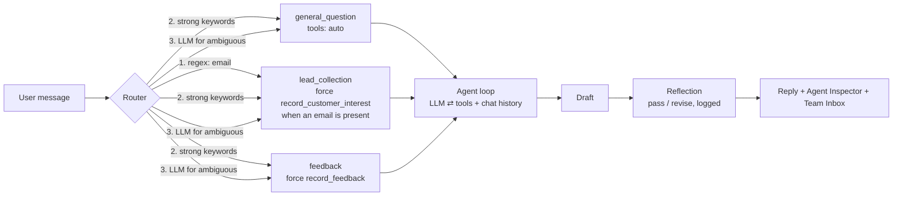

# 🌿 Sateh Green — Agent-Powered Business Assistant

EECE 503P/798S Agentic Systems · Assignment C3 (Introduction to Agents)

**Nour** is the virtual concierge of *Sateh Green*, a fictional rooftop-garden studio in Beirut. She answers questions from the company profile, sends every message down the right path with a 3-layer router, collects leads, logs feedback and unanswered questions through tool calls, and checks her own draft before replying. The custom Gradio UI shows each of these steps live.

## Repo structure

```
business_bot/
├── me/
│   ├── about_business.pdf     # 2-page company profile (services, prices, team, process, policies)
│   └── business_summary.txt   # short summary in a few paragraphs
├── assets/                    # Nour's avatar + screenshot
├── business_agent.ipynb       # main notebook, one section per assignment task
├── app.py                     # same agent + UI, for deployment (HF Spaces)
├── requirements.txt
├── .env.example               # copy to .env and add your key (.env is git-ignored)
└── logs/                      # created at runtime: lead.jsonl, feedback.jsonl, reflections.jsonl
```


## Run on Google Colab

1. **File → Upload notebook** → `business_agent.ipynb`. Then upload `business_bot.zip` in the 📁 Files panel.
2. 🔑 **Secrets** → add `GEMINI_API_KEY` (free key from aistudio.google.com) and turn on notebook access.
3. **Runtime → Run all.** The first cell unzips the project and loads the key. The last cell prints a public `gradio.live` link.


## Run locally

```bash
pip install -r requirements.txt
cp .env.example .env           # put GEMINI_API_KEY=... (or OPENAI_API_KEY=...) in .env
python app.py                  # http://127.0.0.1:7860
```

**Models.** Runs on Gemini (`gemini-3.8-flash` by default) or OpenAI (`gpt-4o-mini`) via the `openai` client. Set `MODEL=` to override. Free tiers have low rate limits, so `429`/`503` errors are retried automatically. `GROQ_API_KEY` is supported as a free fallback **for testing only**; the submitted run uses Gemini.

## How one turn works




## Assignment checklist


| Requirement                               | Implementation                                                                                                              |
| ----------------------------------------- | --------------------------------------------------------------------------------------------------------------------------- |
| Business identity (PDF + TXT)             | `me/about_business.pdf`, `me/business_summary.txt`                                                                          |
| Persona and instructions, clearly labeled | Notebook §2: `PERSONA` (voice) and `INSTRUCTIONS` (8 single-purpose guardrails)                                             |
| Working router                            | §3: regex → keywords → LLM, with an LLM-failure fallback; 16-message test including hard cases ("How *late* are you open?") |
| Two working tools                         | §4: `record_customer_interest`, `record_feedback`, with MCP-style schemas; print + JSONL + optional Pushover                |
| Agent interaction                         | §5–6: route-specific system prompt and tool forcing; tool loop over chat history                                            |
| Gradio ChatInterface                      | §9: `gr.ChatInterface` in a custom "Rooftop Studio" layout with a live Agent Inspector and Team Inbox                       |                                                                           |
| Reflection                                | §7: draft vs. revised reply logged to console, `logs/reflections.jsonl`, and shown in the UI                            


